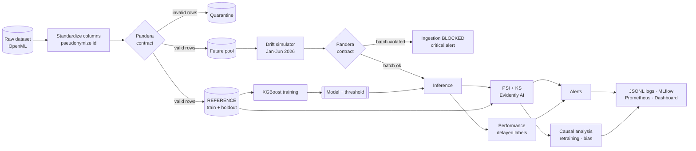

# Credit Scoring Observability

🇧🇷 [Português](README.md) | 🇺🇸 English

A **reliability and monitoring layer** for a credit scoring model: data contracts, drift
simulation and detection, pipeline observability and governance (LGPD, Brazil's data protection law).

It is a small, reproducible reference project: it runs in seconds (about 25 s on the development
machine), with no credentials, no Docker and no external services. It is meant for anyone who wants
to see, end to end, how a model is watched after it goes to production.

**Who may find it useful**

- Data scientists and ML engineers who need to build model monitoring and want a complete example
  to adapt.
- Risk and credit teams who want to understand why a model gets worse without throwing any error.
- MLOps learners looking for a hands-on case of data contracts, PSI, KS and Evidently AI.
- Privacy and compliance people who want to see data protection requirements turned into code.

> The code, logs, alert messages and generated reports are in Brazilian Portuguese. Column names,
> metric names and alert types are in English, so the outputs stay readable.

## The problem in one sentence

A fintech has a credit model in production and the economy has changed (inflation, interest rates,
a new customer profile). The model keeps answering without a single error, and that is the risk:
**the decay is silent**. This project shows how to stop bad data, see the change and prove what
caused it.

## Results

Six monthly production batches (6,000 applications each) compared against the training reference:

| Batch | Diagnosis | Features in critical drift (PSI ≥ 0.2) | Score PSI | AUC | Approval rate | Default rate among approved | Alerts |
|---|---|---|---:|---:|---:|---:|---:|
| Reference (holdout) | n/a | n/a | n/a | 0.854 | 79.7% | 2.5% | n/a |
| Jan/26 | Stable | 0 | 0.001 | 0.860 | 80.1% | 2.5% | 0 |
| Feb/26 | Stable | 0 | 0.002 | 0.857 | 79.9% | 2.5% | 0 |
| Mar/26 | Stable (warning) | 0 | 0.048 | 0.832 | 76.7% | 2.7% | 2 |
| Apr/26 | Data drift | 1: `age` | 0.174 | 0.850 | 72.7% | 2.6% | 5 (includes 1 blocked delivery) |
| May/26 | Data drift + decay | 3: `age`, `revolving_utilization`, `monthly_income` | 0.291 | 0.739 | 70.4% | 5.6% | 7 |
| Jun/26 | Data drift + decay | 4: the above + `debt_ratio` | 0.415 | **0.677** | 68.4% | **9.2%** | 7 |

Three things the numbers show:

1. **The monitoring does not cry wolf.** January and February (control, no drift) raise zero alerts.
2. **Data drift and concept drift have different symptoms.** Up to April the population shifts and
   the approval rate drops 7 points, but AUC holds. From May on, AUC plunges and the default rate
   among approved customers nearly quadruples.
3. **The main cause is invisible to distribution tests.** The causal analysis (below) isolates the
   unemployment shock: on its own it cuts AUC by 0.185 **without moving any feature**, with a score
   PSI of 0.002.

Evidence committed under [`reports/`](reports/):

| File | What it is |
|---|---|
| [`reports/dashboard.html`](reports/dashboard.html) | Observability dashboard (model, drift, alerts, contract, pipeline, causality, bias) |
| [`reports/evidently/drift_2026-0X.html`](reports/evidently/) | Evidently AI report for each batch (PSI, KS and classification quality) |
| [`reports/monitoring_summary.json`](reports/monitoring_summary.json) | Every number from the run, in one file |
| [`reports/logs/*.jsonl`](reports/logs/) | Structured logs: pipeline tasks, alerts and application log |
| [`reports/metrics.prom`](reports/metrics.prom) | The same metrics in Prometheus exposition format |
| [`reports/contract_violation_demo.json`](reports/contract_violation_demo.json) | Evidence of the contract blocking a faulty batch |
| [`reports/causal_interventions.csv`](reports/causal_interventions.csv) | Causal analysis table |

> The HTML files are self-contained: download the repository and open them with a double click
> (GitHub does not render HTML in the file view).

## Architecture



| Layer | Tool | Why |
|---|---|---|
| Model | XGBoost (scikit-learn API) | Industry standard for tabular credit data; trains in seconds |
| Data contract | Pandera | Contract as Python code, *lazy* validation (all failures at once) |
| Drift | Evidently AI + in-house PSI/KS | Evidently builds the visual report; the in-house version drives alerts and is testable |
| Tracking | MLflow (tracking + Model Registry) | Auditable timeline: one training run + one run per batch |
| Metrics | `prometheus-client` (`.prom` file) | The same metrics can be taken to Prometheus + Grafana |
| Logs | JSON Lines | A format Datadog, Loki and CloudWatch ingest without a custom parser |
| Dashboard | Static HTML + SVG (Jinja2) | Opens offline, no server; works as versioned evidence |

## How to run

Requires Python 3.11+ (tested on 3.12 and 3.14). No credentials needed: the dataset comes from OpenML.

```bash
git clone https://github.com/henriquedevops/credit-scoring-observability.git
cd credit-scoring-observability

make install        # creates .venv and installs (or: uv sync)
make pipeline       # ~25 s: ingestion, training, 6 monitored batches, reports
make contract-demo  # the contract accepting a good batch and blocking a bad one
make mlflow-ui      # http://127.0.0.1:5000, experiment credit-scoring-observability
make test           # 42 tests, 93% coverage
```

Then open `reports/dashboard.html` in your browser.

## Dataset

**Give Me Some Credit** (Kaggle, 2011), downloaded from [OpenML (id 46929)](https://www.openml.org/d/46929):
150,000 customers, 10 features and the label "serious delinquency within the next two years" (6.7%
positives). It was chosen because it has more than 5,000 samples, it has features with economic
meaning for simulating drift (income, age, revolving credit usage, debt ratio) and it arrives
**genuinely dirty**, which gives the data contract real work to do.

**Reference × Production split** (`src/credit_monitor/data/prepare.py`):

| Set | Rows | Use |
|---|---:|---|
| Reference (train) | 52,869 | Trains the model |
| Reference (holdout) | 17,623 | Measures the model and is the yardstick for drift and performance |
| Future pool | 46,995 | Raw material for the production batches; never seen by the model |
| Quarantine | 32,513 | Raw rows rejected by the contract |

The reference is never mixed with production: the holdout has the same distribution as the training
set but was never seen by the model, so it is a fair yardstick both for "has the population
changed?" and for "has the model gotten worse?".

## Data validation and contract

Contract in [`src/credit_monitor/contracts/credit_contract.py`](src/credit_monitor/contracts/credit_contract.py)
(version 1.0.0). Any violation blocks the whole batch before inference.

| # | Hard rule | Reason |
|---|---|---|
| 1 | `client_id` required, 16 hex chars, **unique** | No duplicates; id is always pseudonymized |
| 2 | `age` between 18 and 100 | Credit only for adults; 0 and 109 are data entry errors |
| 3 | `monthly_income` **not null**, > 0 and ≤ 100,000 | Income is a core input of the score |
| 4 | `debt_ratio` between 0 and 10 | Above that it signals missing or zeroed income at the source |
| 5 | `revolving_utilization` between 0 and 2 | Raw data reaches 50,708 (unit error) |
| 6 | Late payment counters between 0 and 20 | 96 and 98 are sentinel codes, not counts |
| 7 | `dependents` not null, between 0 and 20 | Used by the model; null means an incomplete record |
| 8 | No fully duplicated rows | Job reprocessing at the source |
| 9 | `strict=True`: any column outside the contract blocks the batch | Keeps `cpf` (Brazilian tax ID), `name` etc. out of the analytics layer |
| 10 | `coerce=False`: wrong type is an error | Nothing is silently "fixed" |

The contract acts at two points, with different policies:

- **Reference curation**, with a *per-row* policy: good rows go on, bad rows go to quarantine with
  the violated rule recorded. Result: 32,513 of 150,000 rows (21.7%) rejected, 29,731 of them for
  missing income.
- **Production gate**, with a *per-batch* policy: one violation blocks the whole batch. In April 2026
  the pipeline receives a faulty delivery (null and negative income, age 0 and 16, sentinel 98,
  duplicates and a `cpf` column); the contract raises `DataContractError`, the batch goes to
  quarantine, a critical alert is raised and only the corrected delivery reaches the model.

```text
$ make contract-demo
1) Lote LIMPO  -> contrato OK (2000 linhas)
2) Lote COM ERROS (entrega defeituosa do sistema de origem)
   INGESTÃO BLOQUEADA: lote demo-defeituoso: contrato VIOLADO: 301 falhas em 2040 linhas
   Violações por regra:
     - monthly_income: not_nullable                    100
     - client_id: field_uniqueness                      80
     - linha inteiramente duplicada                     40
     - age: in_range(18, 100)                           30
     - late_90_days: in_range(0, 20)                    20
     - debt_ratio: in_range(0, 10)                      20
     - monthly_income: greater_than(0)                  10
     - coluna fora do contrato: cpf                      1
```

(Output in Portuguese: the clean batch passes; the faulty batch is BLOCKED with 301 failures in
2,040 rows, listed by rule, including "fully duplicated row" and "column outside the contract: cpf".)

**Baseline model** (`src/credit_monitor/models/train.py`): XGBoost with 300 trees of depth 4.
On the holdout: AUC 0.854, KS 0.560 (logistic regression for comparison: AUC 0.843). The decision
threshold (score ≥ 0.084 is denied) is the one that approves 80% of the training portfolio. The most
important features are the three late payment counters and revolving utilization.

## Drift simulation and detection

### Simulation (`src/credit_monitor/drift/simulate.py`)

Each mechanism is a function with an intensity from 0 to 1, so they can be switched on one at a time:

| Mechanism | What changes | Type | Schedule (intensity) |
|---|---|---|---|
| Income inflation | `monthly_income` rises up to +70% nominal | Data drift | Mar 0.35 → Jun 1.0 |
| Credit stress | Up to 55% of customers use more revolving credit; `debt_ratio` up to +60% | Data drift | Mar 0.30 → Jun 1.0 |
| New customer profile | Customers under 35 up to 7× more likely | Data drift (covariate shift) | Mar 0.30 → Jun 1.0 |
| Unemployment shock | Good payers with a clean history start defaulting; **no feature changes** | Concept drift | May 0.5 → Jun 1.0 |

January and February have no drift: they are the control group. The maximum intensities are a
deliberately strong stress scenario, meant to exercise the monitoring.

### Detection (`src/credit_monitor/drift/`)

Two complementary measures per feature, always against the reference:

- **PSI** (*Population Stability Index*): effect size. Thresholds: < 0.10 stable; 0.10 to 0.20
  warning; ≥ 0.20 critical. This is the metric that raises alerts.
- **Kolmogorov-Smirnov**: hypothesis test (α = 0.05) with the D statistic. With 6,000 rows per
  batch the p-value becomes too sensitive: from March on, KS rejects H0 in 8 of 11 columns,
  including features with a PSI of 0.01 that only moved through correlation with age. So KS is
  kept as evidence, and the decision to alert belongs to PSI.

PSI per feature and month (committed run):

| Feature | Jan | Feb | Mar | Apr | May | Jun |
|---|---:|---:|---:|---:|---:|---:|
| `age` | 0.001 | 0.002 | 0.107 ▲ | **0.279** | **0.394** | **0.464** |
| `revolving_utilization` | 0.002 | 0.003 | 0.046 | 0.179 ▲ | **0.308** | **0.436** |
| `monthly_income` | 0.002 | 0.002 | 0.062 | 0.160 ▲ | **0.225** | **0.276** |
| `debt_ratio` | 0.002 | 0.001 | 0.038 | 0.099 | 0.154 ▲ | **0.223** |
| `score` (prediction) | 0.001 | 0.002 | 0.048 | 0.174 ▲ | **0.291** | **0.415** |
| other 6 features | < 0.01 | < 0.01 | < 0.02 | < 0.04 | < 0.07 | < 0.08 |

▲ warning · **bold** critical

The **Evidently AI** report for each batch (`reports/evidently/`) runs the same tests with
per-feature histograms, plus classification quality compared to the reference. Evidently's PSIs and
the in-house ones agree on the features (for example, `age` in June: 0.522 and 0.464); the
difference comes from the binning. PSI depends on it, which is why the project fixes the rule
(reference deciles; one bin per value for discrete features).

## Pipeline and model observability

### Centralized logs

Every task runs inside `tracker.task(...)` (`src/credit_monitor/observability.py`), which writes a
JSON line with status, duration, CPU, memory and volume. Three files:

| File | Content | Example use |
|---|---|---|
| `tasks.jsonl` | One line per task: `task`, `batch`, `status`, `duration_ms`, `rows_in`, `max_rss_mb`, `error` | Failure rate per task, latency per stage |
| `alerts.jsonl` | One line per alert: `kind`, `severity`, `batch`, `metric`, `value`, `threshold`, `action` | Alert routing |
| `pipeline.jsonl` | Structured application log, with the same `run_id` | Debugging |

### Tracking with MLflow

`make mlflow-ui` opens the `credit-scoring-observability` experiment:

- `train-baseline` run: hyperparameters, holdout metrics, feature importance, ingestion summary and
  the model registered as `credit-scoring-xgb` in the Model Registry;
- `monitor-2026-01` … `monitor-2026-06` runs: PSI and KS for each column, performance metrics, alert
  count, blocked deliveries, latency, the `diagnosis` tag and the Evidently HTML as an artifact.
  Because metrics are logged with a `step`, the UI plots the month-by-month evolution.

**Traces.** Each pipeline run also produces a trace (MLflow Tracing): the `credit_scoring_pipeline`
root, one `monitor_batch <month>` span per batch and one span per `RunTracker` task, with alerts as
events on the span that raised them. Spans only carry aggregates (counts, PSI, AUC). The destination
follows two environment variables, read in `config.py`:

| Variable | Default | Use |
|---|---|---|
| `MLFLOW_TRACKING_URI` | `sqlite:///mlflow.db` | Where runs and traces are stored; use `http://127.0.0.1:5000` to write through the `make mlflow-ui` server |
| `MLFLOW_EXPERIMENT_ID` | `0` | Experiment that receives the traces (runs stay in `credit-scoring-observability`) |

### Documented health metrics

| Group | Metric | Source | Threshold / SLO | Value in the run |
|---|---|---|---|---|
| Pipeline | Status of each task (success/failure) | `tasks.jsonl` | 0 unexpected failures | 49 successes, 1 failure (the expected contract block) |
| Pipeline | Duration per task and total | `tasks.jsonl` | tracked | 22 s total |
| Pipeline | Volume per batch (`rows`) | `tasks.jsonl` | ≥ 5,000 rows | 6,000 in every batch |
| Infrastructure | Inference latency per 1,000 rows | `score_batch` | ≤ 50 ms | worst batch: 2.9 ms |
| Infrastructure | Process peak memory | `max_rss_mb` | tracked | ~820 MB |
| Quality | Deliveries blocked by the contract | `validate_contract` | critical alert on every block | 1 (Apr/26) |
| Quality | Invalid batches that reached the model | pipeline | 0 | 0 |
| Drift | PSI per feature | `detect_drift` | warning ≥ 0.10; critical ≥ 0.20 | see table above |
| Drift | Share of features in critical drift | `detect_drift` | critical ≥ 30% | 40% in Jun/26 |
| Drift | Score PSI (prediction drift) | `detect_drift` | warning ≥ 0.10; critical ≥ 0.20 | 0.415 in Jun/26 |
| Model | AUC drop vs. reference | `evaluate_with_labels` | warning ≥ 0.02; critical ≥ 0.05 | 0.177 in Jun/26 |
| Model | Approval rate and default rate among approved | `evaluate_with_labels` | tracked | 68.4% and 9.2% in Jun/26 |
| Alerts | Count per batch and severity | `alerts.jsonl` | tracked | 21 (15 critical) |

Alert types: `DATA_CONTRACT_VIOLATION`, `FEATURE_DRIFT`, `DATASET_DRIFT`, `PREDICTION_DRIFT` and
`PERFORMANCE_DEGRADATION`. Every alert carries a recommended action.

### Dashboard

`reports/dashboard.html` brings everything into one page: overall status, four time series of model
health, a PSI heatmap by feature and month, reference × production distributions, the alert table,
contract results, SLOs, pipeline tasks, causal analysis, retraining and bias.

### Prometheus and Grafana integration (optional)

`reports/metrics.prom` exposes the metrics as *gauges* (`credit_feature_psi`, `credit_model_auc`,
`credit_alerts`, `credit_pipeline_tasks` …). Point node_exporter's *textfile collector* at the file,
or push it to a Pushgateway, to get the same numbers in Grafana.

## Governance

### Data protection plan (LGPD)

The LGPD (Lei Geral de Proteção de Dados, Law 13,709/2018) is Brazil's general data protection law,
close in spirit to the GDPR. Article numbers below refer to it.

**1. Inventory and handling of personal data (PII)**

| Data | Classification | Handling in this project |
|---|---|---|
| Name, CPF (tax ID), e-mail, address | Direct identifier | **Not ingested.** The contract is `strict`: a `cpf` column blocks the batch (tested in `test_pii_column_is_blocked`) |
| `client_id` | Pseudonym | Salted SHA-256 of the internal id, truncated to 16 hex chars. The salt comes from the `CREDIT_MONITOR_ID_SALT` environment variable, outside the code and git |
| Age, income, dependents, late payment history | Personal data (financial) | Used only for credit assessment; kept out of git (`data/` in `.gitignore`) |
| Racial origin, health, religion, biometrics (art. 5, II) | Sensitive personal data | **Not collected.** Art. 11 does not list "credit protection" as a legal basis for sensitive data |

Points of attention:

- **Pseudonymization is not anonymization.** Whoever holds the salt can link the pseudonym back to
  the customer, which is desirable (it allows data subject requests to be served), but it keeps the
  data under the LGPD (art. 12 and art. 13, §4).
- **Reports and logs contain only aggregates.** PSI, histograms and metrics do not expose individual
  records; that is why `reports/` can be versioned and `data/` cannot.
- **The dataset used here is public and has no identifiers.** The pseudonymized id is simulated to
  demonstrate the control; in production the salt would live in a secrets vault.

**2. Legal basis for the credit decision**

| Processing | Legal basis (LGPD) |
|---|---|
| Credit assessment and granting | **Credit protection** (art. 7, X), together with Law 12,414/2011 (Brazilian positive credit registry) and the Consumer Protection Code, art. 43 |
| Data collection in the credit application | **Pre-contractual steps at the data subject's request** (art. 7, V) |
| Drift monitoring and model retraining | Same purpose (keeping the credit decision correct); if treated as a secondary purpose, **legitimate interest** (art. 7, IX), with a documented balancing test |
| Retention for audit and regulators | **Compliance with a legal or regulatory obligation** (art. 7, II) |

Consent is not used as the basis: it could be withdrawn at any time, which is incompatible with an
ongoing credit operation.

**3. Automated decisions and data subject rights (art. 18 and art. 20)**

- The data subject may request a **review** of a decision made solely by automated processing and
  receive **clear information about the criteria** used (art. 20, caput and §1). What the project
  provides for this: feature importance is logged in MLflow; the score and threshold for each batch
  are traceable by `run_id`; and the threshold routes cases to analysis, which enables a human review
  channel.
- Access, correction and deletion (art. 18) are served through `client_id`, which the controller can
  link back to the customer using the salt.

**4. Retention plan**

| Data | Proposed period | After the period |
|---|---|---|
| Raw batches in quarantine | 30 days | Deletion (only useful for diagnosis with the source team) |
| Production batches (features + score + decision) | 5 years after the decision | Deletion or anonymization |
| Reference dataset (training) | While the model is in production + 5 years | Anonymization by aggregation |
| Delinquency information | At most 5 years (Consumer Protection Code, art. 43, §1) | Deletion |
| Aggregated logs, metrics and reports | 5 years | May be kept (no personal data) |
| MLflow models and runs | Model lifetime + 5 years | Archiving |

The periods are a proposed policy for a fictional scenario; in a real institution they must be
validated by the legal team and the data protection officer (DPO) against the applicable Central Bank
of Brazil rules. Deletion at the end of processing follows arts. 15 and 16.

**5. Privacy by Design and by Default: where each principle shows up in the code**

| Principle | Where it is |
|---|---|
| Proactive, not reactive | The contract blocks PII and invalid data **before** inference, instead of cleaning up afterwards |
| Privacy as the default | `data/` ignored by git by default; id always pseudonymized on entry |
| Privacy embedded into design | Minimization is a schema rule (`strict=True`), not a recommendation in a document |
| Full functionality | All monitoring works with aggregates and pseudonyms only |
| End-to-end security | Salt outside the code; separate quarantine; defined retention periods |
| Visibility and transparency | Versioned contract, structured logs, `run_id` everywhere, MLflow as audit trail (art. 37) |
| Respect for the user | Human review possible; explainable criteria; bias metrics tracked |

Other planned controls: a data protection impact assessment (RIPD, art. 38) before going to
production, since this is large-scale automated decision-making; and incident notification to the
ANPD (the Brazilian data protection authority) and to data subjects (art. 48).

### Bias mitigation

The model uses **age** as a feature. Age is not sensitive data under the LGPD, but treating age
groups disproportionately breaches the non-discrimination principle (art. 6, IX). The pipeline
measures this on every run (`src/credit_monitor/analysis/fairness.py`, output in
`reports/fairness_by_age.csv`):

| Age group | Approval (reference) | Disparate impact | Approval (Jun/26) | Disparate impact | Good payers denied (Jun/26) |
|---|---:|---:|---:|---:|---:|
| 18-29 | 64.4% | **0.71** | 58.0% | **0.66** | 38.2% |
| 30-44 | 71.1% | **0.78** | 61.9% | **0.71** | 33.6% |
| 45-59 | 79.5% | 0.87 | 73.3% | 0.84 | 25.1% |
| 60+ | 91.4% | 1.00 | 87.5% | 1.00 | 11.2% |

Disparate impact = group approval rate ÷ approval rate of the most approved group; below 0.80
(the four-fifths rule) is a warning sign.

The finding is uncomfortable and is recorded as such: **the model is already below 0.80 for people
under 45 from day one, and drift makes it worse**, precisely when the fintech starts acquiring more
young customers (from 6% to 20% of the portfolio). Part of the gap reflects real risk (young
customers default more in the reference: 11.1% versus 3.5% for 60+), but the rate of good payers
denied between 18 and 29 is more than three times the rate for 60+.

Mitigation plan:

1. Treat disparate impact < 0.80 as a monitored metric, with the same weight as a drift alert.
2. Evaluate the model **without the age feature** and weigh the AUC cost against the fairness gain.
3. If age is kept, calibrate thresholds per group only with legal backing; the safer alternative is
   mandatory human review for denials in groups below 0.80.
4. Re-evaluate at every retraining: retraining on recent data can amplify the bias.
5. Remember that dropping the feature is not enough: other features (credit lines, real estate
   loans) correlate with age and can act as a *proxy*.

### Causal analysis of the decay

In June everything changed at once, so correlation cannot tell which change caused the problem.
Because the drift is simulated, we can do what is impossible in the real economy: **intervene**.
Each row switches on a single mechanism at full intensity, with the same customers and the same seed
(`src/credit_monitor/analysis/causal.py`):

| Intervention | Features in critical drift | Score PSI | AUC | Δ AUC | Δ approval | Default rate among approved |
|---|---|---:|---:|---:|---:|---:|
| Control (nothing changes) | none | 0.002 | 0.863 | 0 | 0 | 2.7% |
| Income inflation only | `monthly_income` | 0.003 | 0.860 | −0.003 | +0.6 p.p. | 2.7% |
| Credit stress only | `revolving_utilization`, `debt_ratio` | 0.242 | 0.858 | −0.005 | **−7.4 p.p.** | 2.3% |
| New profile only (younger) | `age` | 0.039 | 0.849 | −0.014 | −5.3 p.p. | 2.9% |
| **Unemployment shock only** | **none** | **0.002** | **0.678** | **−0.185** | 0.0 p.p. | **9.2%** |
| All data drifts, no shock | 4 | 0.411 | 0.833 | −0.030 | −11.2 p.p. | 2.9% |
| Everything (June 2026) | 4 | 0.415 | 0.677 | −0.186 | −11.5 p.p. | 9.2% |

Conclusions:

- **The AUC drop is caused by concept drift.** The unemployment shock alone accounts for −0.185 of
  the −0.186 observed. The four data drifts together explain only −0.030.
- **The approval drop is caused by data drift.** Credit stress (−7.4 p.p.) and the new profile
  (−5.3 p.p.) explain the −11.5 p.p.; the shock does not change approvals.
- **An alarm is not damage.** Income inflation triggers critical drift on `monthly_income` and
  barely affects the model: the feature carries only 1.8% of the importance.
- **Damage does not raise an alarm.** The most destructive mechanism moves no feature and not even
  the score. No distribution test detects it; only the arrival of labels reveals the problem. Hence
  the need to monitor performance with delayed labels, not just drift.

Limit of the analysis: it is causal **within the simulator**, where the mechanisms are known and
independent by construction. In real production, attribution needs other techniques: reweight the
batch to the reference distribution and check whether performance recovers (separating covariate
shift from concept drift), compare cohorts before and after a dated event, and track calibration by
segment.

### Prescription: mitigation plan

| Signal | Immediate action | Structural action |
|---|---|---|
| Contract violated | Block the batch, quarantine, notify the source team | Version the contract; run the same validation at the producer |
| Feature drift at warning | Investigate the source; check more often | Record the cause found |
| Critical or dataset drift | Open an incident; tell real change apart from a pipeline defect | Review the credit policy for the new audience |
| Prediction drift | Review the approval threshold | Prioritize collecting recent labels |
| Performance decay | Strengthen manual review in the affected score bands | Retrain on a recent window and validate out of time |

Retraining was tested (`reports/retrain_experiment.json`): reference + labeled batches from March to
May, evaluated on June, which was left out of training.

| Model, evaluated on Jun/26 | AUC | Approval | Default rate among approved |
|---|---:|---:|---:|
| In production, original threshold | 0.677 | 68.4% | 9.2% |
| In production, threshold recalibrated to approve 80% | 0.677 | 80.0% | 10.1% |
| Retrained on recent data | 0.701 | 80.0% | 9.3% |

Retraining helps, but recovers only part of the loss (AUC from 0.677 to 0.701): the shock hits
customers who, given the available features, are indistinguishable from good payers. The honest
prescription is that **retraining is not enough**: new features that capture the new mechanism are
needed (employment status, industry), and meanwhile the credit policy should be tightened.

## Adapting it to your model

The project uses credit as an example, but the structure works for any tabular classifier.

1. **Columns and thresholds**: adjust `FEATURES`, `TARGET` and the PSI, AUC and SLO thresholds in
   `src/credit_monitor/config.py`.
2. **Contract**: rewrite the rules in `contracts/credit_contract.py` from a profile of your raw
   data. Every limit should be backed by a real row that justifies it.
3. **Production batches**: replace the simulator (`drift/simulate.py`) with reading your real
   batches. The rest of the pipeline only needs one DataFrame per period, plus the labels when they
   arrive.
4. **Reference**: keep a slice of the training data the model has not seen. It is the yardstick for
   drift and for performance.
5. **Alerts**: review the recommended actions in `monitoring/alerts.py` to match your team's process.

The simulator stays useful after the swap: it lets you test whether your monitoring fires when it
should, before a real drift happens.

## Repository layout

```text
credit-scoring-observability/
├── src/credit_monitor/
│   ├── config.py                  # paths, columns, thresholds and SLOs
│   ├── observability.py           # JSONL logs, RunTracker (tasks) and alerts
│   ├── pipeline.py                # end-to-end orchestration
│   ├── data/prepare.py            # download, pseudonymization, reference x production
│   ├── contracts/
│   │   ├── credit_contract.py     # Pandera contract
│   │   └── demo.py                # good batch passes, bad batch is blocked
│   ├── models/train.py            # XGBoost baseline + credit metrics
│   ├── drift/
│   │   ├── simulate.py            # drift mechanisms and monthly schedule
│   │   ├── stats.py               # PSI and Kolmogorov-Smirnov
│   │   └── detect.py              # Evidently report
│   ├── monitoring/
│   │   ├── alerts.py              # alert rules and diagnosis
│   │   ├── tracking.py            # MLflow and Prometheus export
│   │   ├── dashboard.py           # HTML dashboard
│   │   └── templates/dashboard.html.j2
│   └── analysis/
│       ├── causal.py              # interventions and retraining experiment
│       └── fairness.py            # bias by age group
├── tests/                         # 42 tests (synthetic data; includes end-to-end)
├── reports/                       # versioned evidence (dashboard, Evidently, logs)
├── .github/workflows/ci.yml       # lint -> test
├── Makefile
└── pyproject.toml
```

## Limitations

- The drift is **simulated**; the intensities are a stress scenario, not a forecast.
- Each batch's labels are available immediately. In real credit they take months, and during that
  gap prediction drift is the only signal.
- Monthly batches in files: no streaming, no inference API and no orchestrator. The focus is the
  monitoring layer; each pipeline task can become an Airflow task without changing the logic.
- The retention periods and legal bases are a proposal for a fictional scenario and are not a
  substitute for legal advice.

## License and credits

The project started as coursework for a graduate program in Machine Learning Engineering and was
organized to serve as a reference for anyone building model monitoring.

Code under the MIT license. Dataset: Credit Fusion and Will Cukierski, *Give Me Some Credit*,
Kaggle, 2011, via OpenML (id 46929).
