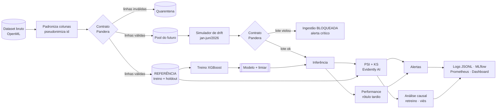

# Credit Scoring Observability

Camada de **sustentação e confiabilidade** para um modelo de Credit Scoring: contratos de dados,
simulação e detecção de drift, observabilidade de pipeline e governança (LGPD).

> Tech Challenge — Fase 4 (*Model Monitoring and Security*) da pós-graduação em Machine Learning
> Engineering (FIAP).
>
> 🎥 **Vídeo STAR (5 min):** _link a inserir após a gravação_

## O problema em uma frase

Uma fintech tem um modelo de crédito em produção e a economia mudou (inflação, juros, novo público).
O modelo continua respondendo sem erro nenhum — e é esse o risco: a **degradação é silenciosa**.
Este projeto mostra como interceptar dado ruim, enxergar a mudança e provar o que a causou.

## Resultado

Seis lotes mensais de produção (6.000 pedidos cada) comparados com a referência de treino:

| Lote | Diagnóstico | Features em drift crítico (PSI ≥ 0,2) | PSI do score | AUC | Aprovação | Inadimplência nos aprovados | Alertas |
|---|---|---|---:|---:|---:|---:|---:|
| Referência (holdout) | — | — | — | 0,854 | 79,7% | 2,5% | — |
| jan/26 | Estável | 0 | 0,001 | 0,860 | 80,1% | 2,5% | 0 |
| fev/26 | Estável | 0 | 0,002 | 0,857 | 79,9% | 2,5% | 0 |
| mar/26 | Estável (atenção) | 0 | 0,048 | 0,832 | 76,7% | 2,7% | 2 |
| abr/26 | Data drift | 1 — `age` | 0,174 | 0,850 | 72,7% | 2,6% | 5 (inclui 1 entrega bloqueada) |
| mai/26 | Data drift + degradação | 3 — `age`, `revolving_utilization`, `monthly_income` | 0,291 | 0,739 | 70,4% | 5,6% | 7 |
| jun/26 | Data drift + degradação | 4 — as anteriores + `debt_ratio` | 0,415 | **0,677** | 68,4% | **9,2%** | 7 |

Três coisas que os números mostram:

1. **O monitoramento não alarma à toa.** Janeiro e fevereiro (controle, sem drift) geram zero alertas.
2. **Data drift e concept drift têm sintomas diferentes.** Até abril a população muda e a taxa de
   aprovação cai 7 pontos, mas o AUC se mantém. A partir de maio o AUC despenca e a inadimplência
   entre os aprovados quase quadruplica.
3. **A causa principal é invisível para testes de distribuição.** A análise causal (abaixo) isola o
   choque de desemprego: sozinho ele derruba o AUC em 0,185 **sem mover nenhuma feature** e com PSI
   do score de 0,002.

Evidências versionadas em [`reports/`](reports/):

| Arquivo | O que é |
|---|---|
| [`reports/dashboard.html`](reports/dashboard.html) | Dashboard de observabilidade (modelo, drift, alertas, contrato, pipeline, causalidade, viés) |
| [`reports/evidently/drift_2026-0X.html`](reports/evidently/) | Relatório do Evidently AI de cada lote (PSI, KS e qualidade de classificação) |
| [`reports/monitoring_summary.json`](reports/monitoring_summary.json) | Todos os números da execução, em um arquivo |
| [`reports/logs/*.jsonl`](reports/logs/) | Logs estruturados: tarefas do pipeline, alertas e log de aplicação |
| [`reports/metrics.prom`](reports/metrics.prom) | As mesmas métricas no formato de exposição do Prometheus |
| [`reports/contract_violation_demo.json`](reports/contract_violation_demo.json) | Evidência do contrato bloqueando um lote defeituoso |
| [`reports/causal_interventions.csv`](reports/causal_interventions.csv) | Tabela da análise causal |

> Os HTMLs são autocontidos: baixe o repositório e abra com dois cliques (o GitHub não renderiza
> HTML na visualização de arquivo).

## Arquitetura



| Camada | Ferramenta | Por quê |
|---|---|---|
| Modelo | XGBoost (scikit-learn API) | Padrão de mercado para crédito tabular; treina em segundos |
| Contrato de dados | Pandera | Contrato como código Python, validação *lazy* (todas as falhas de uma vez) |
| Drift | Evidently AI + implementação própria de PSI/KS | Evidently gera o relatório visual; a implementação própria alimenta alertas e é testável |
| Rastreamento | MLflow (tracking + Model Registry) | Linha do tempo auditável: um run de treino + um run por lote |
| Métricas | `prometheus-client` (arquivo `.prom`) | Gancho com a stack Prometheus + Grafana da Fase 3 |
| Logs | JSON Lines | Formato que Datadog, Loki e CloudWatch ingerem sem parser |
| Dashboard | HTML + SVG estático (Jinja2) | Abre offline, sem servidor; serve de evidência versionada |

## Como executar

Requer Python 3.11+ (testado em 3.12 e 3.14). Nenhuma credencial é necessária: o dataset vem do OpenML.

```bash
git clone https://github.com/henriquedevops/credit-scoring-observability.git
cd credit-scoring-observability

make install        # cria .venv e instala (ou: uv sync)
make pipeline       # ~25 s: ingestão, treino, 6 lotes monitorados, relatórios
make contract-demo  # o contrato aceitando um lote bom e bloqueando um ruim
make mlflow-ui      # http://127.0.0.1:5000 — experimento credit-scoring-observability
make test           # 42 testes, 93% de cobertura
```

Depois abra `reports/dashboard.html` no navegador.

## Dataset

**Give Me Some Credit** (Kaggle, 2011), obtido do [OpenML (id 46929)](https://www.openml.org/d/46929):
150.000 clientes, 10 features e o rótulo "inadimplência grave nos próximos dois anos" (6,7% de
positivos). Foi escolhido porque atende ao mínimo de 5.000 amostras, tem as variáveis que fazem
sentido econômico para simular drift (renda, idade, uso do rotativo, comprometimento de renda) e
chega **sujo de verdade** — o que dá trabalho real ao contrato de dados.

**Separação Referência × Produção** (`src/credit_monitor/data/prepare.py`):

| Conjunto | Linhas | Uso |
|---|---:|---|
| Referência — treino | 52.869 | Treina o modelo |
| Referência — holdout | 17.623 | Mede o modelo e serve de régua para drift e performance |
| Pool do futuro | 46.995 | Matéria-prima dos lotes de produção; o modelo nunca vê |
| Quarentena | 32.513 | Linhas brutas barradas pelo contrato |

A referência nunca é misturada com produção: o holdout tem a mesma distribuição do treino, mas não
foi visto pelo modelo, então é uma régua justa tanto para "a população mudou?" quanto para "o modelo
piorou?".

## Etapa 1 — Validação de dados e contrato

Contrato em [`src/credit_monitor/contracts/credit_contract.py`](src/credit_monitor/contracts/credit_contract.py)
(versão 1.0.0). Qualquer violação bloqueia o lote inteiro antes da inferência.

| # | Regra rígida | Motivo |
|---|---|---|
| 1 | `client_id` obrigatório, 16 hex, **único** | Sem duplicatas; id sempre pseudonimizado |
| 2 | `age` entre 18 e 100 | Crédito só para maiores; 0 e 109 são erros de cadastro |
| 3 | `monthly_income` **não nula**, > 0 e ≤ 100.000 | Renda é insumo central do score |
| 4 | `debt_ratio` entre 0 e 10 | Acima disso é sintoma de renda ausente ou zerada na origem |
| 5 | `revolving_utilization` entre 0 e 2 | O bruto chega a 50.708 (erro de unidade) |
| 6 | Contadores de atraso entre 0 e 20 | 96 e 98 são códigos-sentinela, não contagens |
| 7 | `dependents` não nulo, entre 0 e 20 | — |
| 8 | Nenhuma linha inteiramente duplicada | Reprocessamento de job na origem |
| 9 | `strict=True`: coluna fora do contrato bloqueia | Impede que `cpf`, `nome` etc. cheguem à camada analítica |
| 10 | `coerce=False`: tipo errado é erro | Nada é "consertado" em silêncio |

O contrato atua em dois pontos, com políticas diferentes:

- **Curadoria da referência** — política *por linha*: linhas boas seguem, linhas ruins vão para
  quarentena com a regra violada registrada. Resultado: 32.513 de 150.000 linhas (21,7%) barradas,
  sendo 29.731 por renda nula.
- **Portão de produção** — política *por lote*: uma violação bloqueia o lote todo. Em abril/2026 o
  pipeline recebe uma entrega defeituosa (renda nula e negativa, idade 0 e 16, sentinela 98,
  duplicatas e uma coluna `cpf`); o contrato levanta `DataContractError`, o lote vai para quarentena,
  um alerta crítico é emitido e só a entrega corrigida segue para o modelo.

```text
$ make contract-demo
1) Lote LIMPO  -> contrato OK (2000 linhas)
2) Lote COM ERROS (entrega defeituosa do sistema de origem)
   INGESTÃO BLOQUEADA: lote demo-defeituoso: contrato VIOLADO — 301 falhas em 2040 linhas
   Violações por regra:
     - monthly_income: not_nullable                    100
     - client_id: field_uniqueness                      80
     - linha inteiramente duplicada                     40
     - age: in_range(18, 100)                           30
     - late_90_days: in_range(0, 20)                    20
     - debt_ratio: in_range(0, 10)                      20
     - monthly_income: greater_than(0)                  10
     - coluna fora do contrato: cpf                      1
```

**Modelo baseline** (`src/credit_monitor/models/train.py`): XGBoost com 300 árvores de profundidade 4.
No holdout: AUC 0,854, KS 0,560 (regressão logística de comparação: AUC 0,843). O limiar de decisão
(score ≥ 0,084 nega) é o que aprova 80% da carteira de treino. As variáveis mais importantes são os
três contadores de atraso e a utilização do rotativo.

## Etapa 2 — Simulação e detecção de drift

### Simulação (`src/credit_monitor/drift/simulate.py`)

Cada mecanismo é uma função com intensidade de 0 a 1, o que permite ligar um de cada vez:

| Mecanismo | O que muda | Tipo | Cronograma (intensidade) |
|---|---|---|---|
| Inflação da renda | `monthly_income` sobe até +70% nominal | Data drift | mar 0,35 → jun 1,0 |
| Estresse de crédito | Até 55% dos clientes usam mais o rotativo; `debt_ratio` até +60% | Data drift | mar 0,30 → jun 1,0 |
| Novo perfil de cliente | Clientes com menos de 35 anos até 7× mais prováveis | Data drift (covariate shift) | mar 0,30 → jun 1,0 |
| Choque de desemprego | Bons pagadores de histórico limpo passam a inadimplir; **nenhuma feature muda** | Concept drift | mai 0,5 → jun 1,0 |

Janeiro e fevereiro não têm drift: são o grupo de controle. As intensidades máximas são um cenário
de estresse deliberadamente forte, para exercitar o monitoramento.

### Detecção (`src/credit_monitor/drift/`)

Duas medidas complementares por variável, sempre contra a referência:

- **PSI** (*Population Stability Index*) — tamanho do efeito. Limiares: < 0,10 estável; 0,10 a 0,20
  atenção; ≥ 0,20 crítico. É a métrica que dispara alertas.
- **Kolmogorov-Smirnov** — teste de hipótese (α = 0,05) com a estatística D. Com 6.000 linhas por
  lote o p-valor fica sensível demais: de março em diante o KS rejeita H0 em 8 das 11 colunas,
  inclusive em variáveis com PSI de 0,01 que só mudaram por correlação com a idade. Por isso o KS
  entra como evidência, e a decisão de alertar fica com o PSI.

PSI por variável e por mês (execução versionada):

| Variável | jan | fev | mar | abr | mai | jun |
|---|---:|---:|---:|---:|---:|---:|
| `age` | 0,001 | 0,002 | 0,107 ▲ | **0,279** | **0,394** | **0,464** |
| `revolving_utilization` | 0,002 | 0,003 | 0,046 | 0,179 ▲ | **0,308** | **0,436** |
| `monthly_income` | 0,002 | 0,002 | 0,062 | 0,160 ▲ | **0,225** | **0,276** |
| `debt_ratio` | 0,002 | 0,001 | 0,038 | 0,099 | 0,154 ▲ | **0,223** |
| `score` (predição) | 0,001 | 0,002 | 0,048 | 0,174 ▲ | **0,291** | **0,415** |
| demais 6 variáveis | < 0,01 | < 0,01 | < 0,02 | < 0,04 | < 0,07 | < 0,08 |

▲ atenção · **negrito** crítico

O relatório do **Evidently AI** de cada lote (`reports/evidently/`) traz os mesmos testes com
histogramas por variável, mais a qualidade de classificação comparada com a referência. Os PSIs do
Evidently e os da implementação própria concordam nas features (por exemplo, `age` em junho: 0,522 e
0,464); a diferença vem da escolha de bins — o PSI depende dela, e por isso o projeto fixa a regra
(decis da referência; um bin por valor em variáveis discretas).

## Etapa 3 — Observabilidade de pipelines e modelos

### Logs centralizados

Toda tarefa roda dentro de `tracker.task(...)` (`src/credit_monitor/observability.py`), que grava uma
linha JSON com status, duração, CPU, memória e volume. Três arquivos:

| Arquivo | Conteúdo | Exemplo de uso |
|---|---|---|
| `tasks.jsonl` | Uma linha por tarefa: `task`, `batch`, `status`, `duration_ms`, `rows_in`, `max_rss_mb`, `error` | Taxa de falha por tarefa, latência por etapa |
| `alerts.jsonl` | Uma linha por alerta: `kind`, `severity`, `batch`, `metric`, `value`, `threshold`, `action` | Roteamento de alertas |
| `pipeline.jsonl` | Log de aplicação estruturado, com o mesmo `run_id` | Depuração |

### Rastreamento com MLflow

`make mlflow-ui` abre o experimento `credit-scoring-observability`:

- run `train-baseline`: hiperparâmetros, métricas do holdout, importância das features, resumo da
  ingestão e o modelo registrado como `credit-scoring-xgb` no Model Registry;
- runs `monitor-2026-01` … `monitor-2026-06`: PSI e KS de cada coluna, métricas de performance,
  contagem de alertas, entregas bloqueadas, latência, a tag `diagnosis` e o HTML do Evidently como
  artefato. Como as métricas são registradas com `step`, a UI desenha a evolução mês a mês.

### Métricas de saúde documentadas

| Grupo | Métrica | Fonte | Limiar / SLO | Valor na execução |
|---|---|---|---|---|
| Pipeline | Status de cada tarefa (sucesso/falha) | `tasks.jsonl` | 0 falhas inesperadas | 49 sucessos, 1 falha (o bloqueio esperado do contrato) |
| Pipeline | Duração por tarefa e total | `tasks.jsonl` | — | 22 s no total |
| Pipeline | Volume por lote (`rows`) | `tasks.jsonl` | ≥ 5.000 linhas | 6.000 em todos |
| Infraestrutura | Latência de inferência por 1.000 linhas | `score_batch` | ≤ 50 ms | pior lote: 2,9 ms |
| Infraestrutura | Pico de memória do processo | `max_rss_mb` | — | ~820 MB |
| Qualidade | Entregas bloqueadas pelo contrato | `validate_contract` | alerta crítico a cada bloqueio | 1 (abr/26) |
| Qualidade | Lotes inválidos que chegaram ao modelo | pipeline | 0 | 0 |
| Drift | PSI por feature | `detect_drift` | atenção ≥ 0,10; crítico ≥ 0,20 | ver tabela acima |
| Drift | Fração de features em drift crítico | `detect_drift` | crítico ≥ 30% | 40% em jun/26 |
| Drift | PSI do score (drift de predição) | `detect_drift` | atenção ≥ 0,10; crítico ≥ 0,20 | 0,415 em jun/26 |
| Modelo | Queda de AUC contra a referência | `evaluate_with_labels` | atenção ≥ 0,02; crítico ≥ 0,05 | 0,177 em jun/26 |
| Modelo | Taxa de aprovação e inadimplência nos aprovados | `evaluate_with_labels` | acompanhamento | 68,4% e 9,2% em jun/26 |
| Alertas | Quantidade por lote e severidade | `alerts.jsonl` | — | 21 (15 críticos) |

Tipos de alerta: `DATA_CONTRACT_VIOLATION`, `FEATURE_DRIFT`, `DATASET_DRIFT`, `PREDICTION_DRIFT` e
`PERFORMANCE_DEGRADATION`. Todo alerta carrega a ação recomendada.

### Dashboard

`reports/dashboard.html` consolida tudo em uma página: situação geral, quatro séries temporais de
saúde do modelo, mapa de PSI por variável e mês, distribuições referência × produção, tabela de
alertas, resultado do contrato, SLOs, tarefas do pipeline, análise causal, retreino e viés.

### Integração com a Fase 3 (opcional)

`reports/metrics.prom` expõe as métricas como *gauges* (`credit_feature_psi`, `credit_model_auc`,
`credit_alerts`, `credit_pipeline_tasks` …). Basta apontar o *textfile collector* do node_exporter
para o arquivo, ou enviá-lo a um Pushgateway, para ter os mesmos números no Grafana.

## Etapa 4 — Governança

### Plano de proteção de dados (LGPD)

**1. Inventário e tratamento de dados pessoais (PII)**

| Dado | Classificação | Tratamento neste projeto |
|---|---|---|
| Nome, CPF, e-mail, endereço | Identificador direto | **Não entram.** O contrato é `strict`: uma coluna `cpf` bloqueia o lote (testado em `test_pii_column_is_blocked`) |
| `client_id` | Pseudônimo | SHA-256 com sal do id interno, truncado em 16 hex. O sal vem da variável de ambiente `CREDIT_MONITOR_ID_SALT`, fora do código e do git |
| Idade, renda, dependentes, histórico de atrasos | Dado pessoal (financeiro) | Usados só para a finalidade de análise de crédito; ficam fora do git (`data/` no `.gitignore`) |
| Origem racial, saúde, religião, biometria (art. 5º, II) | Dado pessoal sensível | **Não coletados.** O art. 11 não prevê "proteção do crédito" como base legal para dado sensível |

Pontos de atenção:

- **Pseudonimização não é anonimização.** Quem tem o sal consegue religar o pseudônimo ao cliente —
  o que é desejável (permite atender pedidos do titular), mas mantém o dado sob a LGPD (art. 12 e
  art. 13, §4º).
- **Relatórios e logs só têm agregados.** PSI, histogramas e métricas não expõem registros
  individuais; por isso `reports/` pode ser versionado e `data/` não.
- **O dataset usado aqui é público e sem identificadores.** O id pseudonimizado é simulado para
  demonstrar o controle; em produção o sal ficaria em um cofre de segredos.

**2. Base legal para a decisão de crédito**

| Tratamento | Base legal (LGPD) |
|---|---|
| Análise e concessão de crédito | **Proteção do crédito** — art. 7º, X, em conjunto com a Lei 12.414/2011 (Cadastro Positivo) e o CDC, art. 43 |
| Coleta dos dados no pedido de crédito | **Procedimentos preliminares a contrato, a pedido do titular** — art. 7º, V |
| Monitoramento de drift e retreino do modelo | Mesma finalidade (manter a decisão de crédito correta); se tratado como finalidade secundária, **legítimo interesse** — art. 7º, IX, com teste de balanceamento documentado |
| Guarda para auditoria e regulador | **Cumprimento de obrigação legal ou regulatória** — art. 7º, II |

Não se usa consentimento como base: ele poderia ser revogado a qualquer momento, o que é
incompatível com uma operação de crédito em curso.

**3. Decisão automatizada e direitos do titular (art. 18 e art. 20)**

- O titular pode pedir **revisão** de uma decisão tomada só por tratamento automatizado e receber
  **informações claras sobre os critérios** usados (art. 20, caput e §1º). O que o projeto oferece
  para isso: a importância das features é registrada no MLflow; o score e o limiar de cada lote ficam
  rastreáveis por `run_id`; e o limiar encaminha o caso para análise, o que permite um canal de
  revisão humana.
- Acesso, correção e eliminação (art. 18) são atendidos pelo `client_id`, que o controlador consegue
  religar ao cliente com o sal.

**4. Plano de retenção**

| Dado | Prazo proposto | Depois do prazo |
|---|---|---|
| Lotes brutos em quarentena | 30 dias | Eliminação (servem só para diagnóstico com o time de origem) |
| Lotes de produção (features + score + decisão) | 5 anos após a decisão | Eliminação ou anonimização |
| Dataset de referência (treino) | Enquanto o modelo estiver em produção + 5 anos | Anonimização por agregação |
| Informação de inadimplência | Máximo de 5 anos (CDC, art. 43, §1º) | Eliminação |
| Logs, métricas e relatórios agregados | 5 anos | Podem ser mantidos (não contêm dado pessoal) |
| Modelos e runs do MLflow | Vida do modelo + 5 anos | Arquivamento |

Os prazos são uma proposta de política para o cenário fictício; em uma instituição real precisam ser
validados pelo jurídico e pelo encarregado (DPO) contra as normas do Banco Central aplicáveis. A
eliminação ao fim do tratamento segue os arts. 15 e 16.

**5. Privacy by Design e by Default — como cada princípio aparece no código**

| Princípio | Onde está |
|---|---|
| Proativo, não reativo | O contrato barra PII e dado inválido **antes** da inferência, em vez de limpar depois |
| Privacidade como padrão | `data/` ignorado no git por padrão; id sempre pseudonimizado na entrada |
| Privacidade embutida no design | Minimização é regra de schema (`strict=True`), não uma recomendação em documento |
| Funcionalidade total | O monitoramento inteiro funciona só com agregados e pseudônimos |
| Segurança de ponta a ponta | Sal fora do código; quarentena separada; prazos de retenção definidos |
| Visibilidade e transparência | Contrato versionado, logs estruturados, `run_id` em tudo, MLflow como trilha de auditoria (art. 37) |
| Respeito ao titular | Revisão humana possível; critérios explicáveis; métricas de viés acompanhadas |

Outros controles previstos: relatório de impacto (RIPD, art. 38) antes de ir a produção, por se
tratar de decisão automatizada em larga escala; e comunicação de incidentes à ANPD e aos titulares
(art. 48).

### Mitigação de vieses

O modelo usa **idade** como feature. Idade não é dado sensível na LGPD, mas tratar faixas etárias de
forma desproporcional fere o princípio da não discriminação (art. 6º, IX). O pipeline mede isso em
toda execução (`src/credit_monitor/analysis/fairness.py`, saída em `reports/fairness_by_age.csv`):

| Faixa | Aprovação (referência) | Impacto desproporcional | Aprovação (jun/26) | Impacto desproporcional | Bons pagadores negados (jun/26) |
|---|---:|---:|---:|---:|---:|
| 18-29 | 64,4% | **0,71** | 58,0% | **0,66** | 38,2% |
| 30-44 | 71,1% | **0,78** | 61,9% | **0,71** | 33,6% |
| 45-59 | 79,5% | 0,87 | 73,3% | 0,84 | 25,1% |
| 60+ | 91,4% | 1,00 | 87,5% | 1,00 | 11,2% |

Impacto desproporcional = aprovação da faixa ÷ aprovação da faixa mais aprovada; abaixo de 0,80
(regra dos 80%) é sinal de alerta.

O achado é desconfortável e fica registrado: **o modelo já nasce abaixo de 0,80 para quem tem menos
de 45 anos, e o drift piora o quadro** — justamente quando a fintech passa a captar mais jovens
(de 6% para 20% da carteira). Parte da diferença reflete risco real (a inadimplência dos mais jovens
é maior na referência: 11,1% contra 3,5% dos 60+), mas a taxa de bons pagadores negados entre 18 e
29 anos é mais que o triplo da observada nos 60+.

Plano de mitigação:

1. Tratar impacto desproporcional < 0,80 como métrica monitorada, com o mesmo peso de um alerta de drift.
2. Avaliar o modelo **sem a feature idade** e medir o custo em AUC contra o ganho em equidade.
3. Se a idade for mantida, calibrar limiares por faixa só com respaldo jurídico; a alternativa mais
   segura é a revisão humana obrigatória para negativas nas faixas abaixo de 0,80.
4. Reavaliar a cada retreino — retreinar com dados recentes pode amplificar o viés.
5. Lembrar que tirar a variável não basta: outras features (linhas de crédito, imóveis) são
   correlacionadas com idade e podem funcionar como *proxy*.

### Análise causal da degradação

Em junho tudo mudou ao mesmo tempo, então correlação não diz qual mudança causou o problema. Como o
drift é simulado, dá para fazer o que não se faz na economia real: **intervir**. Cada linha liga um
único mecanismo na intensidade máxima, com os mesmos clientes e a mesma semente
(`src/credit_monitor/analysis/causal.py`):

| Intervenção | Features em drift crítico | PSI do score | AUC | Δ AUC | Δ aprovação | Inadimplência nos aprovados |
|---|---|---:|---:|---:|---:|---:|
| Controle (nada muda) | — | 0,002 | 0,863 | — | — | 2,7% |
| Só inflação da renda | `monthly_income` | 0,003 | 0,860 | −0,003 | +0,6 p.p. | 2,7% |
| Só estresse de crédito | `revolving_utilization`, `debt_ratio` | 0,242 | 0,858 | −0,005 | **−7,4 p.p.** | 2,3% |
| Só novo perfil (jovens) | `age` | 0,039 | 0,849 | −0,014 | −5,3 p.p. | 2,9% |
| **Só choque de desemprego** | **nenhuma** | **0,002** | **0,678** | **−0,185** | 0,0 p.p. | **9,2%** |
| Todos os drifts de dados, sem o choque | 4 | 0,411 | 0,833 | −0,030 | −11,2 p.p. | 2,9% |
| Tudo junto (junho/2026) | 4 | 0,415 | 0,677 | −0,186 | −11,5 p.p. | 9,2% |

Conclusões:

- **A queda de AUC é causada pelo concept drift.** O choque de desemprego sozinho responde por
  −0,185 dos −0,186 observados. Os quatro drifts de dados juntos explicam só −0,030.
- **A queda de aprovação é causada pelo data drift.** Estresse de crédito (−7,4 p.p.) e novo perfil
  (−5,3 p.p.) explicam os −11,5 p.p.; o choque não altera a aprovação.
- **Alarme não é dano.** A inflação da renda dispara drift crítico em `monthly_income` e praticamente
  não afeta o modelo — a variável pesa só 1,8% na importância.
- **Dano não gera alarme.** O mecanismo mais destrutivo não move nenhuma feature nem o score. Nenhum
  teste de distribuição o detecta; só a chegada do rótulo revela o problema. Daí a necessidade de
  monitorar performance com rótulo tardio e não só drift.

Limite da análise: é causal **dentro do simulador**, onde os mecanismos são conhecidos e
independentes por construção. Em produção real a atribuição exige outras técnicas: reponderar o lote
para a distribuição de referência e verificar se a performance volta (separa covariate shift de
concept drift), comparar safras antes e depois de um evento datado, e acompanhar a calibração por
segmento.

### Prescrição: plano de mitigação

| Sinal | Ação imediata | Ação estrutural |
|---|---|---|
| Contrato violado | Bloquear o lote, quarentena, acionar o time de origem | Versionar o contrato; rodar a mesma validação no produtor |
| Drift de feature em atenção | Investigar a origem; aumentar a frequência de checagem | — |
| Drift crítico ou de dataset | Abrir incidente; separar mudança real de defeito de pipeline | Revisar a política de crédito para o novo público |
| Drift de predição | Rever o limiar de aprovação | Priorizar a coleta de rótulos recentes |
| Degradação de performance | Reforçar a análise manual nas faixas de score afetadas | Retreinar com janela recente e validar fora do tempo |

O retreino foi testado (`reports/retrain_experiment.json`): referência + lotes rotulados de março a
maio, avaliado em junho, que ficou fora do treino.

| Modelo, avaliado em jun/26 | AUC | Aprovação | Inadimplência nos aprovados |
|---|---:|---:|---:|
| Em produção, limiar original | 0,677 | 68,4% | 9,2% |
| Em produção, limiar recalibrado para aprovar 80% | 0,677 | 80,0% | 10,1% |
| Retreinado com dados recentes | 0,701 | 80,0% | 9,3% |

O retreino ajuda, mas recupera só parte da perda (AUC de 0,677 para 0,701): o choque atinge clientes
que, pelas features disponíveis, são indistinguíveis dos bons pagadores. A prescrição honesta é que
**retreinar não basta** — é preciso trazer variáveis que capturem o novo mecanismo (vínculo
empregatício, setor de atividade) e, enquanto isso, apertar a política de crédito.

## Estrutura do repositório

```text
credit-scoring-observability/
├── src/credit_monitor/
│   ├── config.py                  # caminhos, colunas, limiares e SLOs
│   ├── observability.py           # logs JSONL, RunTracker (tarefas) e alertas
│   ├── pipeline.py                # orquestra tudo de ponta a ponta
│   ├── data/prepare.py            # download, pseudonimização, referência x produção
│   ├── contracts/
│   │   ├── credit_contract.py     # contrato Pandera (Etapa 1)
│   │   └── demo.py                # lote bom passa, lote ruim é bloqueado
│   ├── models/train.py            # baseline XGBoost + métricas de crédito
│   ├── drift/
│   │   ├── simulate.py            # mecanismos de drift e cronograma mensal (Etapa 2)
│   │   ├── stats.py               # PSI e Kolmogorov-Smirnov
│   │   └── detect.py              # relatório Evidently
│   ├── monitoring/
│   │   ├── alerts.py              # regras de alerta e diagnóstico
│   │   ├── tracking.py            # MLflow e exportação Prometheus (Etapa 3)
│   │   ├── dashboard.py           # dashboard HTML
│   │   └── templates/dashboard.html.j2
│   └── analysis/
│       ├── causal.py              # intervenções e experimento de retreino (Etapa 4)
│       └── fairness.py            # viés por faixa etária
├── tests/                         # 42 testes (dados sintéticos; inclui ponta a ponta)
├── reports/                       # evidências versionadas (dashboard, Evidently, logs)
├── .github/workflows/ci.yml       # lint -> test
├── Makefile
└── pyproject.toml
```

## Limitações

- O drift é **simulado**; as intensidades são um cenário de estresse, não uma previsão.
- O rótulo de cada lote fica disponível na hora. Em crédito real ele demora meses, e é nesse
  intervalo que o drift de predição é o único sinal.
- Lotes mensais em arquivo: não há streaming, API de inferência nem orquestrador (a Fase 3 cobriu
  Airflow, FastAPI e Grafana; aqui o foco é a camada de monitoramento).
- Os prazos de retenção e as bases legais são uma proposta para um cenário fictício e não
  substituem parecer jurídico.

## Licença e créditos

Código sob licença MIT. Dataset: Credit Fusion e Will Cukierski, *Give Me Some Credit*, Kaggle, 2011,
via OpenML (id 46929).
